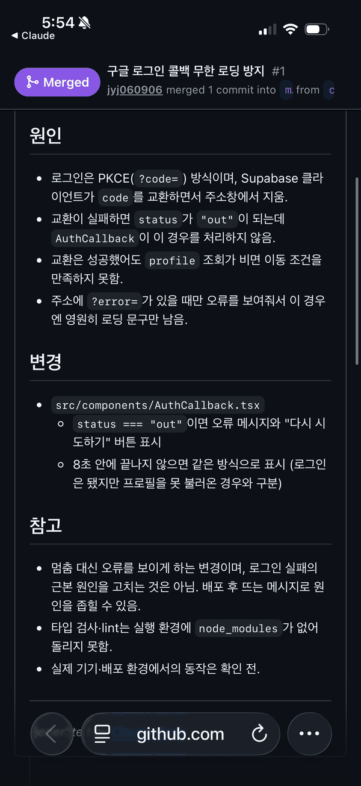
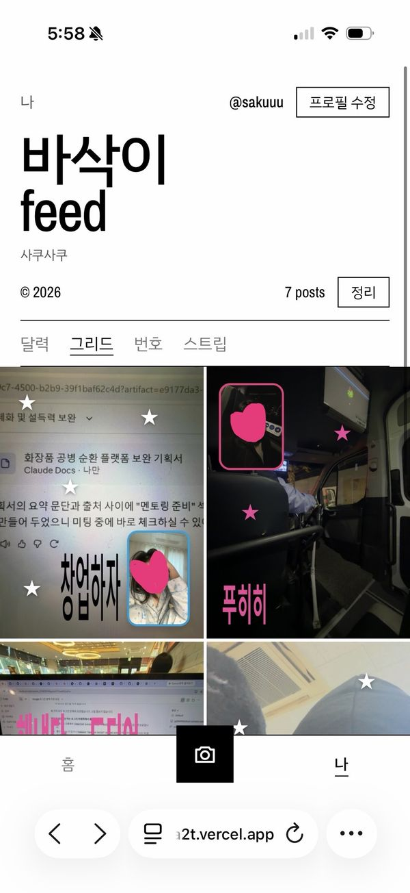
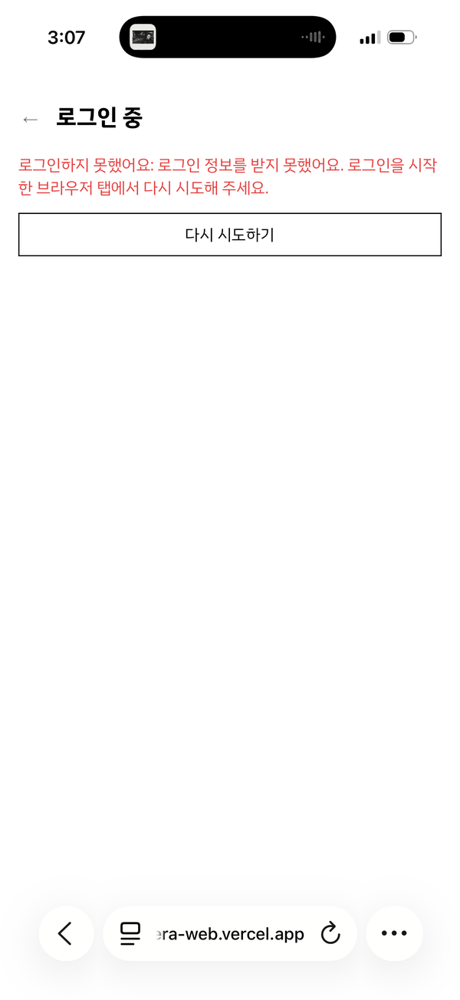

# 듀얼 카메라 (dual-camera-web)

전·후면 사진을 원하는 시점에 각각 찍어 한 장으로 합치고, 꾸민 뒤 친구와 공유하는 반응형 웹 서비스(MVP)입니다.

- 배포 주소: https://dual-camera-web-4a2t.vercel.app
- 기준 문서: [dual-camera-web-plan.md](dual-camera-web-plan.md) (요구사항), [CLAUDE.md](CLAUDE.md) (작업 규칙)

## 1. 목적과 사용자

- **목적:** 촬영 횟수 제한 없이 일상을 기록하고, 두 사진을 합쳐 개성 있게 꾸며 친구와 공유합니다.
- **사용자:** 친구와 사진을 공유하려는 사람, 듀얼샷을 자주 쓰는 사람, 사진을 꾸미기 좋아하는 사람(기획 문서 2장).
- **대상 환경:** 모바일(아이폰·안드로이드) 중심의 반응형 웹. PC는 전면 카메라로 두 장을 찍습니다.

## 2. 실행 방법

필요한 것: Node.js와 npm ([TODO] 권장 Node 버전 확인), Supabase 프로젝트.

```bash
npm install
cp .env.example .env.local   # NEXT_PUBLIC_SUPABASE_URL, NEXT_PUBLIC_SUPABASE_ANON_KEY 입력
npm run dev                  # http://localhost:3000
```

- `.env.local`은 커밋하지 않습니다. 브라우저에 들어가는 키는 공개용(anon/publishable)만 쓰고, `service_role`·`sb_secret_` 키는 넣지 않습니다.
- Supabase 설정(스키마 실행, 구글 로그인, Redirect URL)은 [supabase/README.md](supabase/README.md)를 따릅니다. 설정 점검: `node scripts/check-supabase.mjs`
- 환경변수를 넣지 않아도 촬영·꾸미기는 쓸 수 있고, 로그인·피드만 꺼집니다.
- **Vercel 배포:** 환경변수 두 개를 Production에 넣고 배포합니다. 이 값들은 빌드 때 코드에 들어가므로 바꾸면 다시 배포해야 합니다. Supabase의 Site URL과 Redirect URLs(`<배포 주소>/auth/callback`)에 배포 주소를 등록해야 합니다.
- 빌드·린트: `npm run build`, `npm run lint`

## 3. 작업 과정

1. 2026-10-08 요구사항 문서를 쓰고, 10-09 기획 문서·`CLAUDE.md`·`.gitignore`를 첫 커밋으로 올렸습니다.
2. 같은 날 Next.js 앱을 만들고 촬영·합성 화면을 추가했습니다. 이후 프레임, 보정, 필터, 텍스트, 저장, 계정(Supabase), 친구·팔로우, 피드, 좋아요·댓글, 하단 3탭을 차례로 붙였습니다.
3. 10-29 기획을 "핵심 4개(촬영·간단 꾸미기·친구 피드·추억 달력)" 중심으로 다시 정리했습니다(기획 문서 1-1장).
4. 10-31~11-01 배포 사이트에서 구글 로그인 후 "로그인을 마무리하는 중..."에서 멈추는 문제를 고쳤습니다(PR #1~#4, 아래 5장).
5. 저장소는 이 README 작성 전까지 49개 커밋입니다. [TODO] 단계별 날짜와 소요 시간은 직접 기록한 값으로 보완

## 4. Claude Code 사용 증거

- **규칙 문서:** `CLAUDE.md`에 "확정된 조건만 구현", "요청하지 않은 기능 추가 금지", "기술 스택은 사용자 확인 후 결정", "기기별 동작은 실제 환경에서 확인하기 전에는 동작한다고 말하지 않기" 등을 적어 두었습니다.
- **커밋 기록:** 49개 커밋 중 43개에 Claude Code 공동 작성자 표기가 있습니다(`git log`로 확인).
- **로그인 수정 PR:**

| PR | 내용 |
| --- | --- |
| #1 | 콜백이 무한 로딩되지 않도록 실패·8초 시간 초과 때 오류와 "다시 시도하기" 표시 |
| #2 | 실패 화면에 주소 `code`·해시·검증 쿠키 있음/없음 표시 |
| #3 | 실패 화면에 Supabase 교환 오류 표시 → `401 Invalid API key`로 원인 범위를 좁힘 |
| #4 | 빌드에 들어간 Supabase 주소·키(일부) 표시 |

- 이후 진단 줄은 모두 제거했습니다(커밋 `20e9d86`). 오류 메시지, 시간 초과, 다시 시도 버튼은 남겼습니다.



*PR #1을 아이폰의 GitHub 화면에서 본 모습(Merged). 원인·변경·참고를 적은 PR 본문이 보입니다.*

- [TODO] Claude Code로 만든 이전 기능들의 대화 기록·스크린샷 첨부 위치

## 5. 검증 결과

검증 환경을 구분해 적습니다. **실제 기기**는 사용자가 아이폰 Safari에서 배포 사이트를 직접 확인한 결과이고, **로컬 가짜 카메라**는 같은 코드를 로컬에서 빌드해 Chromium의 가짜 카메라(Playwright)로 돌린 결과입니다. 가짜 카메라는 영상 스트림만 제공하므로 실제 기기 동작의 증거가 아닙니다.

### 정상 케이스

| 시나리오 | 실제 기기(iPhone Safari, 직접 확인) | 로컬 가짜 카메라 |
| --- | --- | --- |
| 구글 로그인 | 통과 | 해당 없음(Supabase 접속 불가) |
| 앞·뒤 카메라 촬영 | 통과 | 통과(두 장 촬영 → 확인 화면, 앞·뒤 구분 없음) |
| 텍스트 추가 | 통과 | 미확인(스크립트가 버튼을 찾지 못함) |
| 꾸미기 탭 진입, 편집본 저장 | [TODO] 실제 기기에서 확인 전 | 통과(JPG 다운로드 발생, 파일 내용은 보지 않음) |
| 피드 게시와 표시 | 통과 | 해당 없음(Supabase 접속 불가) |

### 엣지 케이스

| 시나리오 | 실제 기기 | 로컬 가짜 카메라 |
| --- | --- | --- |
| 카메라 권한 거부 | 안내 표시 통과 | 통과(`NotAllowedError`를 주입해 안내·오류 줄·"다시 시도" 확인) |
| 환경변수 없는 빌드의 로그인 | [TODO] | 통과("로그인 기능이 아직 설정되지 않았어요") |
| 로그인 콜백 실패 | 배포 사이트에서 오류 문구와 "다시 시도하기"가 표시됨을 사용자가 확인(수정 전 키 오류 상황) | 통과(`code` 없이 진입해도 무한 로딩 없음) |

- 검증 기기: [TODO] 아이폰 기종·iOS 버전

### 화면 증거 (아이폰 Safari 캡처)

| 피드 게시와 표시 | 로그인 콜백 실패 화면 |
| --- | --- |
|  |  |
| 새 배포 주소(`…a2t.vercel.app`)의 "나" 탭 그리드, 게시물 7개. 사진 속 얼굴은 가려진 상태로 캡처했습니다. | PR #1 적용 후의 실패 화면(주소창 `…era-web.vercel.app`). 무한 로딩 대신 오류와 "다시 시도하기"가 보입니다. |

## 6. 효과적이었던 방법 3개

1. **기준 문서와 `CLAUDE.md`로 규칙 고정.** 미정 항목을 임의로 정하지 않고, PR은 요청받았을 때만 만들며, 기기에서 확인하지 않은 동작을 "된다"고 쓰지 않는 원칙을 프로젝트 진행 중 지켰습니다.
2. **라이브러리 소스를 직접 읽기.** `node_modules`의 Supabase 클라이언트 코드를 읽어, `code`가 있어도 검증 쿠키가 없으면 교환을 조용히 건너뛰고 로그인 상태가 `out`이 된다는 경로를 확인했습니다.
3. **화면에 진단 정보를 단계적으로 노출.** 개발 환경에서 배포 사이트에 접속할 수 없었으므로, 실패 화면에 한 단계씩 정보를 추가해(주소·쿠키 → 교환 오류 → 빌드 값) 사용자가 본 결과로 원인 범위를 좁혔고, 해결 후 제거했습니다.

## 7. 어려웠던 점 3개

1. **개발 환경의 네트워크 제한.** Claude Code 세션에서 `vercel.app`과 `supabase.co`가 막혀 배포 사이트를 직접 열 수 없었습니다. 배포 검증은 사용자가 실기기에서 확인한 결과에 의존했습니다.
2. **환경변수 원인 추적의 반복.** 같은 `401 Invalid API key`가 여러 번 반복됐습니다. 새 Vercel 프로젝트에 환경변수를 다시 넣은 뒤 로그인이 동작했지만, 어떤 값이 틀렸는지는 확정하지 못했습니다([TODO] 원인 확정 시 기록). 또 이미 머지된 PR에 커밋을 추가해 반영되지 않는 실수로 PR이 #2~#4까지 늘었습니다.
3. **실기기 의존 기능을 자동으로 대체할 수 없음.** 가짜 카메라는 스트림만 제공해 앞·뒤 카메라 전환, 권한 설정 안내 같은 동작은 실제 기기 확인이 필요했습니다. 자동 확인 스크립트도 버튼 이름을 추측하다 한 항목(텍스트 추가)을 확인하지 못했습니다.

## 8. 알려진 한계

- 실기기 검증은 아이폰 Safari 기준입니다. [TODO] 안드로이드, PC 브라우저, 카카오톡 같은 인앱 브라우저는 확인 전
- 기획 문서(2026-10-29 기준)상 **함께 듀얼**과 **음악 텍스트 태그**는 미구현입니다. [TODO] 최신 구현 상태 확인
- 꾸미기 기능은 기획의 "최소화(3가지)" 방향보다 많이 구현돼 있고, 줄이는 시점과 범위는 미정입니다.
- 아이디/비밀번호 가입은 메일이 없어 **비밀번호를 잊으면 찾을 수 없습니다.** 로그인 방법마다 계정이 따로입니다.
- 배포 주소가 바뀌면 Supabase Site URL·Redirect URLs를 다시 등록해야 합니다.
- `supabase/tests/rls.test.mjs`(접근 규칙 검증)는 저장소에 있으나 [TODO] 실행 결과는 확인하지 않았습니다.

## 9. 핵심 파일 5개

| 파일 | 역할 |
| --- | --- |
| `src/components/DualShot.tsx` | 촬영 → 확인 → 꾸미기 → 저장·게시 화면 전체(약 1,750줄) |
| `src/lib/camera.ts` | 카메라 열기, 권한·오류 판별, 광각 전환 |
| `src/lib/exportImage.ts` | 두 사진을 한 장으로 합성해 이미지로 내보내기 |
| `supabase/schema.sql` | 테이블, 접근 규칙(RLS), 트리거(가입 시 프로필 생성 등) |
| `src/lib/auth.tsx` | 로그인 상태·프로필 관리. 구글 복귀 처리는 `src/components/AuthCallback.tsx` |
